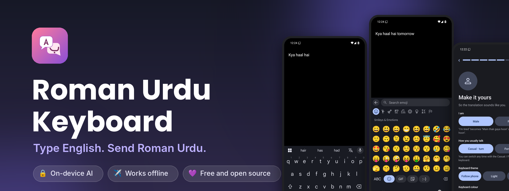
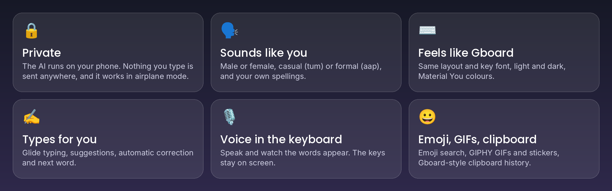

<h1 align="center">
  
</h1>

  Translate <b>English ⇄ Roman Urdu</b> as you type, with Google's Gemma AI running <b>entirely on your phone</b>. 
  Glide typing, autocorrect, voice, emoji, GIFs and clipboard, in a keyboard that feels like Gboard.

  
  
  
  

  <a href="#see-it-work">See it work</a> ·
  <a href="#get-started-in-two-minutes">Install</a> ·
  <a href="#features">Features</a> ·
  <a href="#faq">FAQ</a> ·
  <a href="#privacy-and-permissions">Privacy</a> ·
  <a href="#roadmap">Roadmap</a>

## What you get

  

---

## See it work

  

Type English in any app and tap **Translate** in the toolbar. The text turns into natural Roman Urdu. Type Roman Urdu and it goes
the other way. Tap Translate again to get your original text back.

| You type | You get |
|---|---|
| I'm tired *(male, casual)* | *Main thak gaya hoon* |
| I'm tired *(female, casual)* | *Main thak gayi hoon* |
| Where are you? *(casual)* | *Tum kahan ho?* |
| *Aap kaisay hain?* | How are you? |

*Illustrative. A small model on a phone won't be perfect every time.*

## Get started in two minutes

1. On your Android phone, tap **[Download the APK](https://github.com/pauldeggington/roman-urdu-keyboard/releases/latest/download/roman-urdu-keyboard.apk)**
   (or pick it from the [Releases](https://github.com/pauldeggington/roman-urdu-keyboard/releases) page).
2. Open the file. If Android asks, allow installs from your browser or Files app, then tap **Install**.
3. Open **Roman Urdu Keyboard**. A setup guide walks you through everything, one step per screen:
   download the translator, turn the keyboard on, switch to it, pick your style, and try it.
4. In any app, type something and tap **Translate** above the keys.

  

New versions show up on the Releases page and install over the old one, keeping your settings and the translator.
The app has an **Update** button that opens the download for you.

> **Play Protect warning?** The app is new and not from the Play Store, so Google may show a "harmful app" prompt. Tap
> **More details → Install anyway**. The source code is in this repository, and every release is built here by GitHub Actions.

**You'll need:** Android 12 or newer, an arm64 phone, about 3 GB free storage, and 6 GB of RAM or more.
The first translation after a restart is slower while the model loads. If it feels slow, try *Use the GPU* in the app.

## Features

### Translation
- **English → Roman Urdu** and **Roman Urdu → English**, on the phone, no internet after setup.
- **Auto-detect** the direction, or force it with the direction key.
- **Casual or Formal** tone, shown as a word on the toolbar so you always know which one is on.
- **Male or Female** wording: "I'm tired" becomes *Main thak gaya hoon* or *Main thak gayi hoon*.
- **Two models to choose from**

  | | Gemma 4 E2B | Gemma 3 1B |
  |---|---|---|
  | Best for | Quality, understanding Roman Urdu | Speed and a small download |
  | Size | 2.6 GB | 0.6 GB |
  | Account needed | No | Free Hugging Face token (Google gates it) |

- **Tap Translate again to undo.** The key spins while the model works.
- **Spelling glossary:** tell it your spellings (*bada → barha*) and it uses them every time.
- **Example bank:** for each message the closest example sentences guide the model. Fix a translation in the app and save it as
  an example, and the keyboard learns your style.
- Understands texting shorthand and spelling variants (*kr, nhi, tm, bht*).
- **Translate messages you receive:** select a Roman Urdu message in any app, tap **Translate to English** in the selection menu (under the three dots in some apps), and a sheet shows the English with a Copy button.

### Keyboard
- Gboard's layout and height: borderless letters, pill-shaped ?123, space and Enter, number hints, long-press for accents and symbols.
- Circular key preview, pill popups, Material Symbols icons, the Google Sans key font, vibration on press.
- **Light, dark or follow the phone**, with wallpaper (Material You) colours or 19 swatches.
- Toolbar with a **mic**, **Translate**, **Casual/Formal** and **Auto/EN→RU/RU→EN**. The grid button opens emoji, select all, copy, cut, the clipboard and settings.
- Auto-capital, double space for a full stop, swipe the space bar to move the cursor, hold delete to repeat.

### Typing help

| | |
|---|---|
| **Word suggestions** | The strip above the keys finishes the word and fixes typos while you type. |
| **Automatic correction** | Press space and a clear typo is fixed (*teh → the*, *recieve → receive*, *dont → don't*, *wich → which*). Backspace straight after undoes it and the keyboard stops correcting that word. Names, ABBREVIATIONS and anything that looks like Roman Urdu are left alone. |
| **Next word** | After a word and a space the strip offers what usually follows (*thanks* → *for, a, so*). It uses a small built-in table of everyday English and the word pairs you type, and stays quiet in Roman Urdu text. |
| **Glide typing** (English) | Slide across the letters and lift to type a word. The three best matches show above the keys; tap one to swap, or press backspace to remove the whole word. |
| **Voice typing** | Tap the mic: your words appear as you speak and the keys stay on screen. The mic turns red while it listens. |
| **Learning** | Your own names and spellings are learned on the phone only, never in password, email or address fields. Suggestions, autocorrect and glide typing each have a switch in the app, and one button forgets everything learned. |

  

### Emoji, GIFs and clipboard
- **Emoji screen** with a search field, categories, recents and skin tones, plus **text emoticons** in named groups (Classic, Smiling, Love, Hugging, Flexing and more).
- **GIFs and stickers** from GIPHY, with search and category chips. They are sent as pictures in apps that accept them (WhatsApp, Messages, Gmail and most chat apps) and as a link anywhere else. GIPHY needs a free key: paste it once in the app (*GIFs and stickers* card, with a button to GIPHY's sign-up).
- **Clipboard history** like Gboard's: what you copied in the last hour as cards. Tap to paste, long-press to pin or delete. Off until you turn it on; nothing leaves the phone.

   
   
  

### The app
- A **setup guide** with buttons that jump to the right Android setting, steps that tick themselves off, and a practice box.
  The model downloads in the background with a notification while you finish.
- Model checksum check, and import from a file if you already have it.
- A **Try it** box with direction and tone, editable style rules, the example bank, the glossary, and speed numbers
  (load time and seconds per translation, CPU or GPU).

  

## Privacy and permissions

- Translation runs **on the device**. Nothing you type is sent anywhere.
- Your settings, glossary, examples, learned words and clipboard history stay on the phone. Backups are switched off, and the GIPHY key is stored encrypted.

| Permission | Why |
|---|---|
| Internet | Download the model, read its checksum from Hugging Face, check GitHub for updates, and search GIPHY if you use GIFs or stickers (GIPHY only sees your search words) |
| Microphone | Voice typing. Asked for only when you first tap the mic. Speech is handled by your phone's own recogniser (Google's or the one you chose), not by this app |
| Vibrate | Key feedback |
| Network state | Lets the setup guide offer to wait for Wi-Fi before the big download |

**Check the download.** Every release is built by GitHub Actions from this repository and signed with the same key. The certificate fingerprint (SHA-256) is:

`ae11bae40b0ba26c9d229e7f1bc2cb8eb9e2d7b8b696cca3909c4b2daea522a4`

Verify it with `apksigner verify --print-certs roman-urdu-keyboard.apk`.

## FAQ

<b>Is anything I type sent to a server?</b>

No. Translation, suggestions, autocorrect and learning all happen on the phone. The only network use is listed in the table above.

<b>The first translation is slow.</b>

The model has to load into memory after a restart or after the keyboard has been idle. It then stays warm while you type. If it still feels slow, try *Use the GPU* in the app, or the smaller Gemma 3 1B model.

<b>Autocorrect changed a word I wanted. How do I stop it?</b>

Press Backspace right after it: the original comes back and that word is left alone from then on. You can switch automatic correction off in the app without losing suggestions.

<b>Autocorrect does nothing in an app.</b>

Some fields ask keyboards not to suggest (passwords, email, addresses, some search boxes), and the keyboard respects that. It also stays out of the way when your recent text looks like Roman Urdu, so it never "fixes" Roman Urdu into English.

<b>GIFs and stickers say a key is needed.</b>

GIPHY needs a free API key. Open the app, find the *GIFs and stickers* card, tap the button to get one, and paste it in. It takes a minute.

<b>Voice typing says it needs a connection.</b>

Some phones' speech recognisers work online only. Download an offline speech pack for your language in your phone's speech or voice settings and try again.

<b>Android warns about the install.</b>

The app isn't from the Play Store, so Play Protect may show a prompt. Tap **More details → Install anyway**. You can check the fingerprint above first.

<b>Why does Roman Urdu spelling differ from what I use?</b>

There is no standard spelling. Add your own in the app's glossary (*bada → barha*) and it is used every time.

## Roadmap

What works today is described above. Still to come:

- Roman Urdu suggestions, completion and glide typing (these are English only for now).
- Voice typing language switch (English and Urdu).
- Layouts for other languages.
- Faster first translation (an experimental smaller R8 build is attached to test releases for comparing).

Ideas are welcome as [issues](https://github.com/pauldeggington/roman-urdu-keyboard/issues).

## Test builds

Every change is built as a pre-release first (for example `v2.0.112-test`). Install one over the normal app if you want to try things early; the in-app Update button ignores them and your settings stay.

<b>Project layout</b>

| Path | What it is |
|---|---|
| `app/src/main/java/com/paul/urdukb/` | The app: setup guide, model engine and download, translate and tone logic, glossary, example bank, updater |
| `app/src/main/java/com/paul/urdukb/ime/` | The keyboard: input service, key view, toolbar, emoji screen, colours |
| `app/src/main/assets/roman_urdu/` | Spelling variant data (see [CREDITS.md](CREDITS.md)) |
| `tools/convert_ruwv.py` | Converts the spelling data into the file the app reads |
| `scripts/shots.sh`, `.github/workflows/preview.yml` | Boots the keyboard on an emulator in CI and takes screenshots |
| `scripts/make_readme_images.py` | Turns those screenshots into the pictures and animation in this README |

## Status

A personal project, young and changing quickly. Roman Urdu has no standard spelling and a small on-device model makes mistakes,
so check anything important. Bug reports and ideas are welcome as [issues](https://github.com/pauldeggington/roman-urdu-keyboard/issues).

## Credits and licence

Built with Google's Gemma models and LiteRT-LM, Google Sans and Material Symbols, and the RUWV-NSR spelling dataset by
Mudasar Ahmed. Full credits are in [CREDITS.md](CREDITS.md).

Open source under the **GNU General Public License v3.0**. See [LICENSE](LICENSE).
