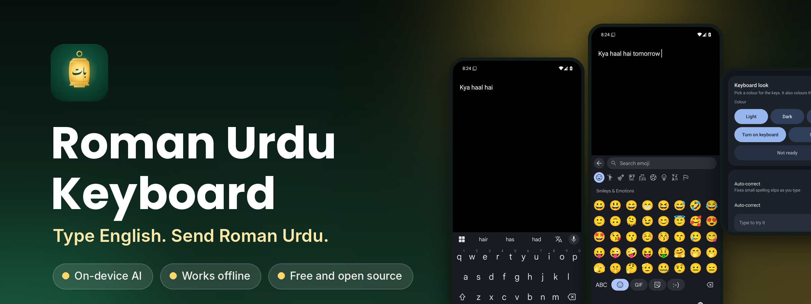
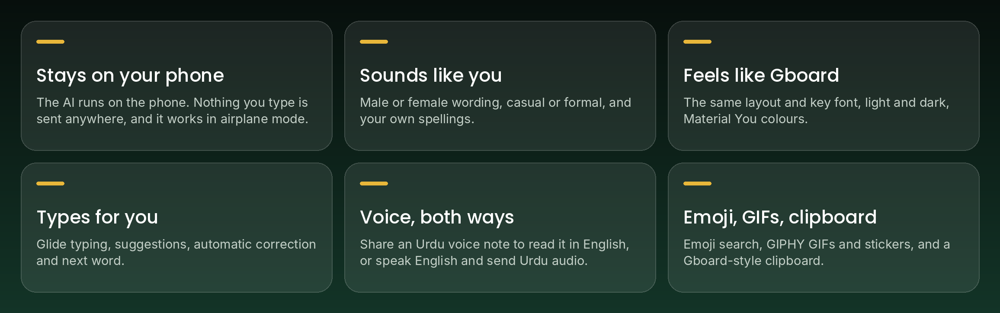
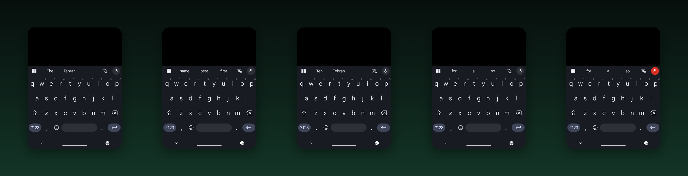
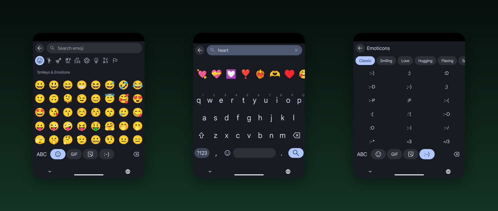
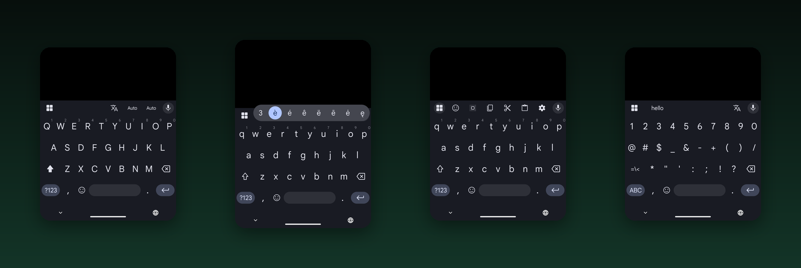
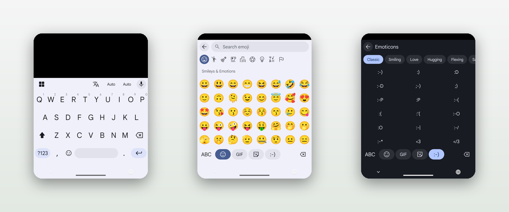
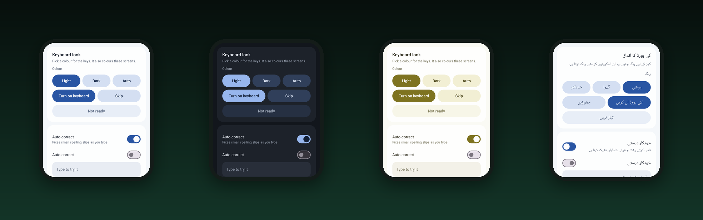

<h1 align="center">
  
</h1>

  Translate <b>English ⇄ Roman Urdu</b> as you type. Google's Gemma AI runs <b>on your phone</b>, so it works offline. 
  Glide typing, autocorrect, voice, emoji, GIFs and clipboard, in a keyboard that feels like Gboard.

  
  
  
  
  

  <a href="#see-it-work">See it work</a> ·
  <a href="#get-started-in-two-minutes">Install</a> ·
  <a href="#features">Features</a> ·
  <a href="#faq">FAQ</a> ·
  <a href="#privacy-and-permissions">Privacy</a> ·
  <a href="#roadmap">Roadmap</a>

## What you get

  

---

## See it work

   
  Click for the full-quality video (1080p, 44 seconds).

Type English in any app and tap **Translate** in the toolbar. The text becomes natural Roman Urdu. Type Roman Urdu and it goes
the other way. Tap Translate again to get your original text back.

| You type | You get |
|---|---|
| I'm tired *(male, casual)* | *Main thak gaya hoon* |
| I'm tired *(female, casual)* | *Main thak gayi hoon* |
| Where are you? *(casual)* | *Tum kahan ho?* |
| *Aap kaisay hain?* | How are you? |

*Illustrative. A small model on a phone won't be right every time.*

## Get started in two minutes

**From Google Play** (once the listing is live): search for *Roman Urdu Keyboard* and install it. Play updates the app for you.

**From GitHub:**

1. On your Android phone, open the **[latest release](https://github.com/pauldeggington/roman-urdu-keyboard/releases/latest)**
   and download `RomanUrduKeyboard-<version>.apk`. The file with `-standard` in its name is the unshrunk fallback and does not include the translator.
2. Open the file. If Android asks, allow installs from your browser or Files app, then tap **Install**.
3. Open **Roman Urdu Keyboard**. A setup guide takes you through it, one step per screen: turn the keyboard on, switch to it, pick your style, and try it.
4. In any app, type something and tap **Translate** above the keys.

The small **Gemma 3 1B** translator is built into the app, so there is nothing to download to start. For better translations and for
voice, you can add **Gemma 4** (a one-time 2.6 GB download). Installing Gemma 4 removes Gemma 3 to save space.

New versions appear on the Releases page and install over the old one, keeping your settings and the translator.
The GitHub app has an **Update** button that opens the download for you. The Google Play version has no updater, because Play updates it.

> **Moving from version 2.4 or earlier.** Version 2.5 has a new app ID (`com.lanternkeys.urdukb`, needed to publish on Google Play), so it installs **next to** the old app instead of over it. Install it, run the short setup, switch to the new keyboard, then uninstall the old one. The old app keeps working but will not get updates.

> **Large APK.** The GitHub APK is about 570 MB because Gemma 3 is inside it. If something misbehaves, the `-standard.apk` (about 33 MB, no translator inside) installs over the top, and the app then downloads a model in setup.

> **Play Protect warning?** The app is new and not from the Play Store, so Google may show a "harmful app" prompt. Tap
> **More details → Install anyway**. Every release is built by GitHub Actions and signed with the same key (see Privacy below).

**You'll need:** Android 12 or newer, an arm64 phone, about 1.5 GB free storage (about 4 GB if you add Gemma 4), and 6 GB of RAM or more.
The first translation after a restart is slower while the model loads. If it feels slow, try *Use the GPU* in the app.

## Features

### Translation
- **English → Roman Urdu** and **Roman Urdu → English**, on the phone, with no internet.
- **Auto-detect** the direction, or force it with the direction key.
- **Five tones:** Casual, Formal, Poetic, Funny and Respectful (for elders). Leave it on **Auto** and the keyboard chooses one from what you wrote.
- **Male or female wording:** "I'm tired" becomes *Main thak gaya hoon* or *Main thak gayi hoon*.
- **Spelling that follows the Urdu letters,** so *dh*, *rh* and *ph* come out the way an Urdu reader expects, not the Hindi way.
- **Meaning, not word order:** Urdu puts the verb last and English does not, so the model translates what is meant.
- **Two models**

  | | Gemma 4 E2B | Gemma 3 1B |
  |---|---|---|
  | Best for | Quality, understanding Roman Urdu, voice | Speed, and nothing to download |
  | Size | 2.6 GB (download) | 0.6 GB (built into the app) |
  | Voice features | Yes | No |

  Gemma 3 comes inside the app. Once you install Gemma 4, Gemma 3 is removed and only Gemma 4 is used.
- **Tap Translate again to undo.** The key spins while the model works.
- **Spelling glossary:** tell it your spellings (*bada → barha*) and it uses them every time.
- **Example bank:** for each message the closest example sentences guide the model. Fix a translation in the app and save it as
  an example, and the keyboard learns your style.
- Understands texting shorthand and spelling variants (*kr, nhi, tm, bht*).
- **Translate messages you receive:** select a Roman Urdu message in any app, tap **Translate to English** in the selection menu (under the three dots in some apps), and a sheet shows the English with a Copy button.

### Voice (needs Gemma 4)
- **Urdu voice note to English:** share a voice note from WhatsApp to this app (Share, then Roman Urdu Keyboard). The model listens, writes down what it heard in Roman Urdu, and translates that, with the English double-checked by translating it back.
- **English speech to Urdu audio:** speak English in the app's Voice card and get the Urdu in script and Roman Urdu, read aloud by your phone's own Urdu voice, as an audio file you can send.
- **Careful listening:** each voice note can be heard at several speeds, with the most likely reading chosen and the other readings shown as *Also heard as*.
- With Gemma 3 these features are off, and the app says so. The keyboard's own mic button is separate and works with either model.

### Keyboard
- Gboard's layout and height: borderless letters, pill-shaped ?123, space and Enter, number hints, long-press for accents and symbols.
- Circular key preview, pill popups, Material Symbols icons, the Google Sans key font, vibration on press.
- **Light, dark or follow the phone**, with wallpaper (Material You) colours or 19 swatches.
- Toolbar with a **mic**, **Translate**, **Casual/Formal** and **Auto/EN→RU/RU→EN**. The grid button opens emoji, select all, copy, cut, the clipboard and settings.
- Auto-capital, double space for a full stop, swipe the space bar to move the cursor, hold delete to repeat.

### Typing help

| | |
|---|---|
| **Word suggestions** | The strip above the keys finishes the word and fixes typos while you type. |
| **Automatic correction** | Press space and a clear typo is fixed (*teh → the*, *recieve → receive*, *dont → don't*, *wich → which*). Backspace straight after undoes it and the keyboard stops correcting that word. Names, ABBREVIATIONS and anything that looks like Roman Urdu are left alone. |
| **Next word** | After a word and a space the strip offers what usually follows (*thanks* → *for, a, so*). It uses a small built-in table of everyday English and the word pairs you type, and stays quiet in Roman Urdu text. |
| **Glide typing** (English) | Slide across the letters and lift to type a word. The three best matches show above the keys; tap one to swap, or press backspace to remove the whole word. |
| **Voice typing** | Tap the mic: your words appear as you speak and the keys stay on screen. The mic turns red while it listens. |
| **Learning** | Your own names and spellings are learned on the phone only, never in password, email or address fields. Suggestions, autocorrect and glide typing each have a switch in the app, and one button forgets everything learned. |

  

### Emoji, GIFs and clipboard
- **Emoji screen** with a search field, categories, recents and skin tones, plus **text emoticons** in named groups (Classic, Smiling, Love, Hugging, Flexing and more).
- **GIFs and stickers** from GIPHY, with search and category chips. They are sent as pictures in apps that accept them (WhatsApp, Messages, Gmail and most chat apps) and as a link anywhere else. GIPHY needs a free key: paste it once in the app (*GIFs and stickers* card, with a button to GIPHY's sign-up).
- **Clipboard history** like Gboard's: what you copied in the last hour as cards. Tap to paste, long-press to pin or delete. Off until you turn it on; nothing leaves the phone.

   
   
  

### The app
- A **setup guide** with buttons that jump to the right Android setting, steps that tick themselves off, and a practice box.
  If you add Gemma 4, it downloads in the background with a notification while you finish.
- Model checksum check, and import from a file if you already have it.
- A **Try it** box with direction and tone (Auto or one of five), the example bank, the glossary, and speed numbers
  (load time and seconds per translation, CPU or GPU).

  

## Privacy and permissions

- Translation runs **on the device**. Nothing you type is sent anywhere.
- Your settings, glossary, examples, learned words and clipboard history stay on the phone. Backups are switched off, and the GIPHY key is stored encrypted.
- There is no account, no analytics and no ads. The full policy is on the [privacy page](https://pauldeggington.github.io/roman-urdu-keyboard/privacy.html).

| Permission | Why |
|---|---|
| Internet | Download Gemma 4 if you choose it, check its checksum with Hugging Face, search GIPHY if you use GIFs or stickers (GIPHY only sees your search words), and, in the GitHub version only, check GitHub for updates |
| Microphone | Voice typing and the Voice card. Asked for only when you first use them. The keyboard's mic button uses your phone's own speech recogniser (Google's or the one you chose); the Voice card listens on the phone with Gemma 4 |
| Vibrate | Key feedback |
| Network state | Lets the setup guide offer to wait for Wi-Fi before the big download |

**Check the download.** Every release is built by GitHub Actions and signed with the same key. The certificate fingerprint (SHA-256) is:

`ae11bae40b0ba26c9d229e7f1bc2cb8eb9e2d7b8b696cca3909c4b2daea522a4`

Verify it with `apksigner verify --print-certs roman-urdu-keyboard.apk`.

## FAQ

<b>Is anything I type sent to a server?</b>

No. Translation, suggestions, autocorrect and learning all happen on the phone. The only network use is listed in the permissions table above.

<b>The first translation is slow.</b>

The model has to load into memory after a restart or after the keyboard has been idle. It then stays warm while you type. If it still feels slow, try *Use the GPU* in the app.

<b>Autocorrect changed a word I wanted. How do I stop it?</b>

Press Backspace right after it: the original comes back and that word is left alone from then on. You can switch automatic correction off in the app without losing suggestions.

<b>Autocorrect does nothing in an app.</b>

Some fields ask keyboards not to suggest (passwords, email, addresses, some search boxes), and the keyboard respects that. It also stays out of the way when your recent text looks like Roman Urdu, so it never "fixes" Roman Urdu into English.

<b>GIFs and stickers say a key is needed.</b>

GIPHY needs a free API key. Open the app, find the *GIFs and stickers* card, tap the button to get one, and paste it in. It takes a minute.

<b>Voice typing says it needs a connection.</b>

Some phones' speech recognisers work online only. Download an offline speech pack for your language in your phone's speech or voice settings and try again.

<b>Android warns about the install.</b>

If you installed from GitHub, the app isn't from the Play Store, so Play Protect may show a prompt. Tap **More details → Install anyway**. You can check the fingerprint above first.

<b>Why does Roman Urdu spelling differ from what I use?</b>

There is no standard spelling. Add your own in the app's glossary (*bada → barha*) and it is used every time.

## Roadmap

What works today is described above. Still to come:

- Roman Urdu suggestions, completion and glide typing (these are English only for now).
- Voice typing language switch (English and Urdu).
- Layouts for other languages.
- Faster first translation.
- An App Store version (the website lists it as coming soon).

Ideas are welcome as [issues](https://github.com/pauldeggington/roman-urdu-keyboard/issues).

## Versions

Every release on `main` has a version number (for example **2.1**, build 121) shown in the app, in the release title and in the [changelog](CHANGELOG.md).

## Work in progress

Releases on this page are the finished versions. Work in progress is built on every change but not published as a release; if you want to try one, ask in an issue.

## Status

A personal project, young and changing quickly. Roman Urdu has no standard spelling and a small on-device model makes mistakes,
so check anything important. Bug reports and ideas are welcome as [issues](https://github.com/pauldeggington/roman-urdu-keyboard/issues).

## Credits and licence

Built with Google's Gemma models and LiteRT-LM, Google Sans and Material Symbols, and the RUWV-NSR spelling dataset by
Mudasar Ahmed. Full credits are in [CREDITS.md](CREDITS.md); third-party licence texts are in [licenses/](licenses/).

© 2026 Paul Eggington. All rights reserved. The app's source code is private. The name "Roman Urdu Keyboard", the
lantern icon and the website pictures may not be reused without permission (see [LICENSE](LICENSE)).
Versions up to 2.5 were published as open source under GPL-3.0; copies people already have stay under that licence.
