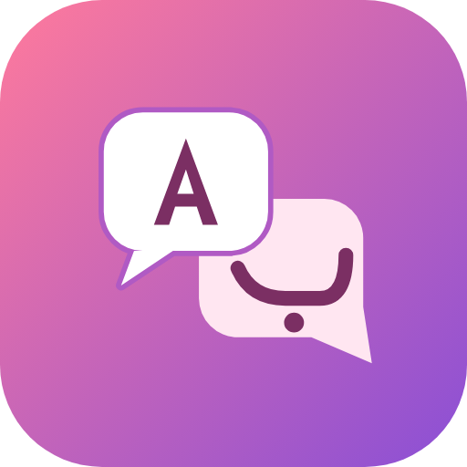
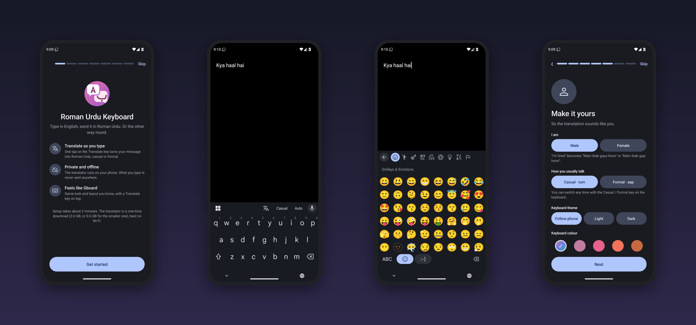
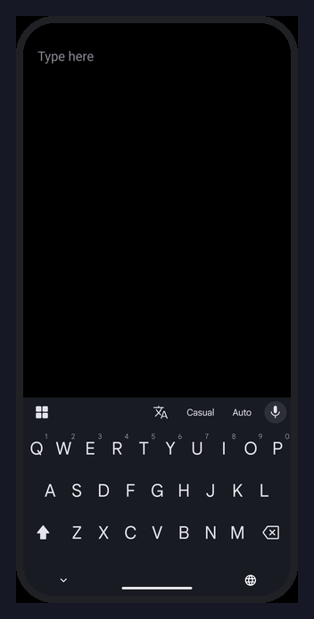
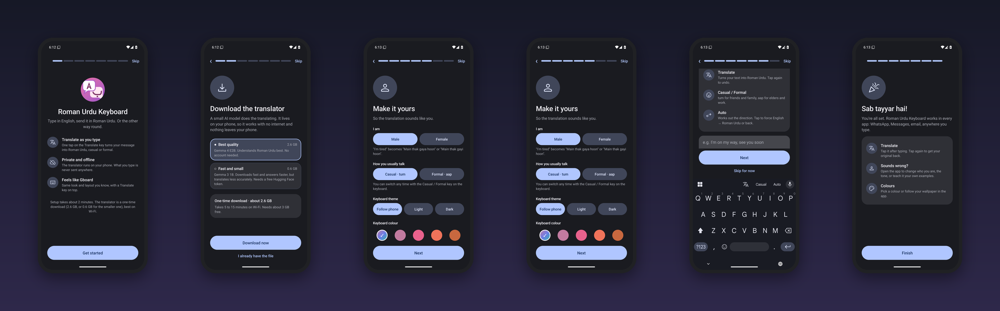
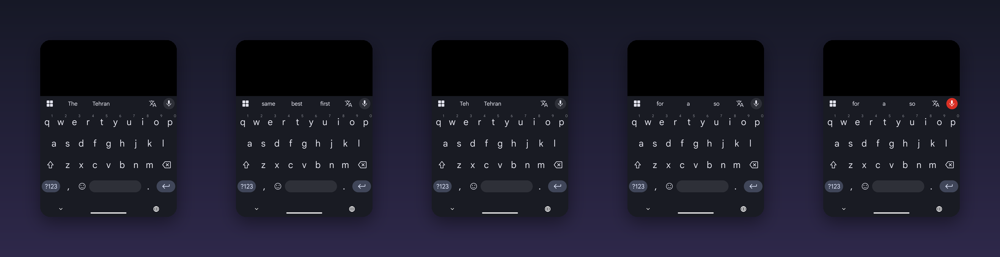
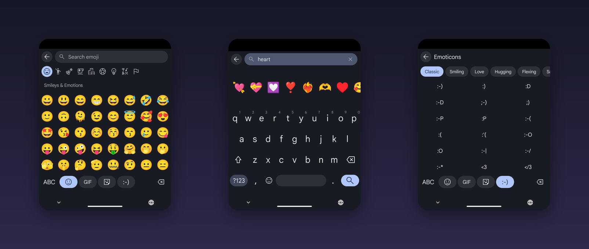
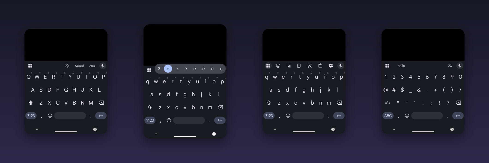
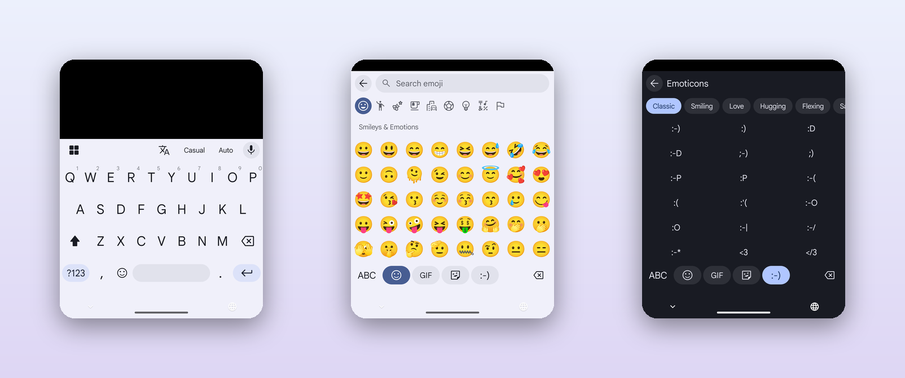
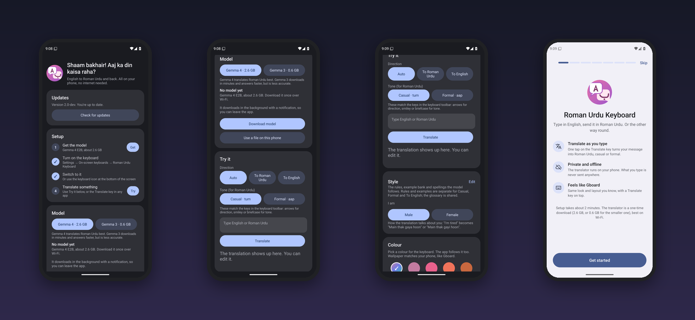

  

<h1 align="center">Roman Urdu Keyboard</h1>

  <b>Type English. Send Roman Urdu.</b> 
  An Android keyboard that translates <b>English ⇄ Roman Urdu</b> as you type, using Google's Gemma AI model
  that runs <b>entirely on your phone</b>.

  
  
  
  

  

---

## See it work

  

Type English in any app and tap **Translate** in the toolbar. The text turns into natural Roman Urdu. Type Roman Urdu and it goes
the other way. Tap Translate again to get your original text back.

| You type | You get |
|---|---|
| I'm tired *(male, casual)* | *Main thak gaya hoon* |
| I'm tired *(female, casual)* | *Main thak gayi hoon* |
| Where are you? *(casual)* | *Tum kahan ho?* |
| *Aap kaisay hain?* | How are you? |

*Illustrative. A small model on a phone won't be perfect every time.*

## Why it's different

<table>
<tr>
<td width="33%" valign="top">

### 🔒 Private
The model runs on the phone. Nothing you type is sent anywhere, and after setup it works in airplane mode.

</td>
<td width="33%" valign="top">

### 🗣️ Sounds like you
Choose **Male or Female**, **casual (*tum*) or formal (*aap*)**, and your own spellings (*kaisay*, *chahtay*, *barha*).

</td>
<td width="33%" valign="top">

### ⌨️ Feels like Gboard
Same proportions, same key font, Material You colours, light and dark. You don't have to learn a new keyboard.

</td>
</tr>
</table>

## Get started in two minutes

1. On your Android phone, tap **[Download the APK](https://github.com/pauldeggington/roman-urdu-keyboard/releases/latest/download/roman-urdu-keyboard.apk)**
   (or pick it from the [Releases](https://github.com/pauldeggington/roman-urdu-keyboard/releases) page).
2. Open the file. If Android asks, allow installs from your browser or Files app, then tap **Install**.
3. Open **Roman Urdu Keyboard**. A setup guide walks you through everything, one step per screen:
   download the translator, turn the keyboard on, switch to it, pick your style, and try it.
4. In any app, type something and tap **Translate** above the keys.

  

New versions show up on the Releases page and install over the old one, keeping your settings and the translator.
The app has an **Update** button that opens the download for you.

> **Play Protect warning?** The app is new and not from the Play Store, so Google may show a "harmful app" prompt. Tap
> **More details → Install anyway**. The source code is in this repository, and every release is built here by GitHub Actions.

**You'll need:** Android 12 or newer, an arm64 phone, about 3 GB free storage, and 6 GB of RAM or more.
The first translation after a restart is slower while the model loads. If it feels slow, try *Use the GPU* in the app.

## Features

### Translation
- **English → Roman Urdu** and **Roman Urdu → English**, on the phone, no internet after setup.
- **Auto-detect** the direction, or force it with the direction key.
- **Casual or Formal** tone, shown as a word on the toolbar so you always know which one is on.
- **Male or Female** wording: "I'm tired" becomes *Main thak gaya hoon* or *Main thak gayi hoon*.
- **Two models to choose from**

  | | Gemma 4 E2B | Gemma 3 1B |
  |---|---|---|
  | Best for | Quality, understanding Roman Urdu | Speed and a small download |
  | Size | 2.6 GB | 0.6 GB |
  | Account needed | No | Free Hugging Face token (Google gates it) |

- **Tap Translate again to undo.** The key spins while the model works.
- **Spelling glossary:** tell it your spellings (*bada → barha*) and it uses them every time.
- **Example bank:** for each message the closest example sentences guide the model. Fix a translation in the app and save it as
  an example, and the keyboard learns your style.
- Understands texting shorthand and spelling variants (*kr, nhi, tm, bht*).
- **Translate messages you receive:** select a Roman Urdu message in any app, tap **Translate to English** in the selection menu (under the three dots in some apps), and a sheet shows the English with a Copy button.

### Keyboard
- Gboard's layout and height: borderless letters, pill-shaped ?123, space and Enter, number hints, long-press for accents and symbols.
- Circular key preview and pill popups, Material Symbols icons, the Google Sans key font, vibration on press.
- Toolbar with a **mic** (voice typing right in the keyboard: your words appear as you speak and the keys stay on screen), **Translate**, **Casual/Formal** and **Auto/EN→RU/RU→EN**.
  The grid button opens emoji, select all, copy, cut, the clipboard and settings.
- **Clipboard history** like Gboard's: the clipboard button in the tools panel shows what you copied in the last hour as cards. Tap one to paste it, long-press to pin or delete. It is off until you turn it on, and nothing leaves the phone.
- **Emoji screen** with a search field, categories, recents and skin tones, plus **text emoticons** in named groups (Classic, Smiling, Love, Hugging, Flexing and more).
- **GIFs and stickers** from GIPHY, with search and category chips. They are sent as pictures in apps that accept them (WhatsApp, Messages, Gmail and most chat apps) and as a link anywhere else.
  GIPHY needs a free key: paste it once in the app (Settings card *GIFs and stickers*, it has a button that opens GIPHY's sign-up).
- **Light, dark or follow the phone**, with wallpaper (Material You) colours or 19 colour swatches.
- **Word suggestions** in the strip above the keys while you type: finishes the word, fixes typos (*teh → the*, *dont → don't*), and learns your own names and Roman Urdu words on the phone only. Never in password, email or address fields, and you can switch it off or forget what it learned.
- **Next-word suggestions**: after a word and a space, the strip offers what usually comes next (*thank* → *you*). It starts from a small built-in table of everyday English and learns the pairs you type, on the phone only. Not used for Roman Urdu text.
- **Automatic correction**: when you press space, a clear typo is fixed for you (*teh → the*, *dont → don't*). Press Backspace straight after to undo it and the keyboard stops correcting that word. Names, ABBREVIATIONS and anything that looks like Roman Urdu are left alone. It has its own switch.
- **Glide typing** (English): slide your finger across the letters and lift to type a word. The three best matches show above the keys; tap one to swap the word, or press backspace to remove the whole word. Switch it off in the app if you prefer.
- Auto-capital, double space for a full stop, swipe the space bar to move the cursor, hold delete to repeat.

   
   
   
  

### The app
- A **setup guide** with buttons that jump to the right Android setting, steps that tick themselves off, and a practice box.
  The model downloads in the background with a notification while you finish.
- Model checksum check, and import from a file if you already have it.
- A **Try it** box with direction and tone, editable style rules, the example bank, the glossary, and speed numbers
  (load time and seconds per translation, CPU or GPU).

  

## Privacy

- Translations run **on the device**. Nothing you type is sent anywhere.
- The `INTERNET` permission is used only to download the model, read its checksum from Hugging Face, check GitHub for a new version, and (if you use the GIF and Sticker tabs) search GIPHY. GIPHY only sees the words you search for.
- The microphone permission is asked for only when you first tap the mic. The keyboard uses your phone's own speech recogniser (Google's or the one you chose), so what you say is handled by that service, not by this app. If the phone has no recogniser, the mic falls back to your phone's voice keyboard.
- Your settings, glossary and examples stay on the phone.

## Not included (yet)

Next-word prediction, glide typing in Roman Urdu (English only for now), and layouts for other languages. GIFs and stickers need your own free GIPHY key (or a release built with one).

<b>Project layout</b>

| Path | What it is |
|---|---|
| `app/src/main/java/com/paul/urdukb/` | The app: setup guide, model engine and download, translate and tone logic, glossary, example bank, updater |
| `app/src/main/java/com/paul/urdukb/ime/` | The keyboard: input service, key view, toolbar, emoji screen, colours |
| `app/src/main/assets/roman_urdu/` | Spelling variant data (see [CREDITS.md](CREDITS.md)) |
| `tools/convert_ruwv.py` | Converts the spelling data into the file the app reads |
| `scripts/shots.sh`, `.github/workflows/preview.yml` | Boots the keyboard on an emulator in CI and takes screenshots |
| `scripts/make_readme_images.py` | Turns those screenshots into the pictures and animation in this README |

## Status

A personal project, young and changing quickly. Roman Urdu has no standard spelling and a small on-device model makes mistakes,
so check anything important. Bug reports and ideas are welcome as [issues](https://github.com/pauldeggington/roman-urdu-keyboard/issues).

## Credits and licence

Built with Google's Gemma models and LiteRT-LM, Google Sans and Material Symbols, and the RUWV-NSR spelling dataset by
Mudasar Ahmed. Full credits are in [CREDITS.md](CREDITS.md).

Open source under the **GNU General Public License v3.0**. See [LICENSE](LICENSE).
