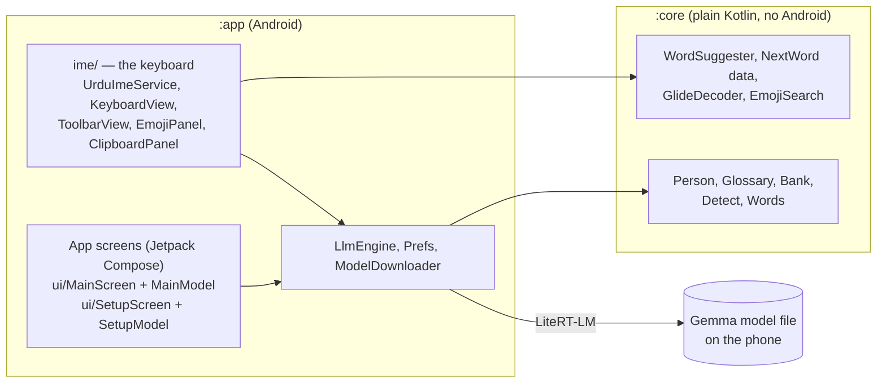

# Architecture

A native Android app in Kotlin. The AI runs on the phone through LiteRT-LM. There is no server.

## Modules

| Module | Contains | Rule |
|---|---|---|
| `:core` | Word suggestions and autocorrect, glide decoding, emoji search, language detection, who-is-speaking tagging, the glossary and example bank | **No Android imports.** Tests run with `./gradlew :core:test` in seconds. |
| `:app` | The input method service and its views, the setup guide and settings screens (Compose), model download, the Gemma engine, GIPHY, clipboard history, voice input | Everything that needs Android. |

New logic that can be written without Android goes in `:core` first.

## The keyboard (`app/.../ime/`)

- `UrduImeService` is the input method service. It owns the views and decides what each key and toolbar button does.
- `KeyboardView` and `ToolbarView` draw the keys and the bar above them directly on a Canvas, like Gboard, so they are fast and look the same on every phone. `Layouts` (in `:core`) describes the rows of keys.
- `EmojiPanel` is the emoji, GIF, sticker and emoticon screen. `ClipboardPanel` is the clipboard screen.
- Typing help: `WordSuggester` (suggestions and autocorrect), `NextWord` and `PersonalWords` (next word and what the phone learns), `GlideDecoder` (glide typing), `VoiceInput` (the mic).
- Keyboard colours come from `KbColors`; settings keys are in `Kb`.

### What happens when you type a letter

1. The key press reaches `UrduImeService.onKey`.
2. The letter is committed to the text box, and the word being typed is tracked.
3. A moment later, suggestions are computed off the main thread (`WordSuggester`) and shown in the strip above the keys.
4. On space or punctuation, autocorrect may replace a clear typo. Backspace straight after undoes it and teaches the word.

## Translation

1. Tapping **Translate** calls `RomanUrdu`, which reads the text, picks the direction (`Detect`) and style (casual, formal, to English).
2. `Person` decides who is speaking and who is addressed (male or female, *tum* or *aap*) and tags the text. `Glossary` applies the person's own spellings. `Bank` picks example sentences close to the text.
3. `LlmEngine` loads the Gemma model (`.litertlm` file in app storage), builds the prompt, runs it and returns text. The engine is loaded when needed and unloaded after a while to free memory.
4. The result replaces the selection. Tapping Translate again restores the original.

## The app screens (Jetpack Compose)

The keyboard stays on Canvas views; the app screens are Compose. Each screen is split in two:

| Screen | What it shows | What it does |
|---|---|---|
| Settings (`MainActivity`) | `ui/MainScreen.kt`: a list of cards | `ui/MainModel.kt`: model download and check, update check, Try it, style editor |
| Setup guide (`SetupActivity`) | `ui/SetupScreen.kt`: one composable per step | `ui/SetupModel.kt`: which step, download and file check, keyboard on or not |
| Translate to English sheet (`TranslateTextActivity`) | one composable in the same file | calls the engine directly |

- `ui/AppTheme.kt` builds the Material theme from the same `Palette` the keyboard settings use (wallpaper colours, or the chosen swatch, light or dark).
- `ui/Components.kt` has the shared pieces: `AppCard`, `PillButton`, `Segmented`, `TextBox`, `SwitchRow`. Use them for new screens.
- The activities only start the model and the screen. To change how something looks, edit the screen file; to change what it does, edit the model.
- All text is in `res/values/strings.xml`, so a translation is one new `values-xx/strings.xml`.

## Data and privacy

- Settings are SharedPreferences (`Prefs`, `Kb`). Learned words, clipboard history and recent GIFs are kept there too, on the phone only. The GIPHY key is stored encrypted with the Android Keystore (`Secrets`).
- Network use: model download (Hugging Face), update check (GitHub), GIPHY search. Nothing typed is sent.

## Build and CI

- `.github/workflows/build.yml`: unit tests, the APK, and a release (`main`) or `-test` pre-release (other branches).
- `.github/workflows/preview.yml`: boots the keyboard on an emulator, drives it with `scripts/shots.sh` and publishes screenshots used for the README images.
- `VERSION` + the CI build number give the version (for example 2.1.122).
