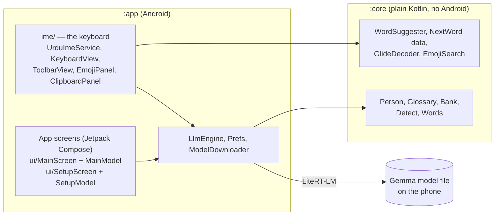

# Architecture

A native Android app in Kotlin. The AI runs on the phone through LiteRT-LM. There is no server.

## Modules

| Module | Contains | Rule |
|---|---|---|
| `:core` | Word suggestions and autocorrect, glide decoding, emoji search, language detection, who-is-speaking tagging, the glossary and example bank | **No Android imports.** Tests run with `./gradlew :core:test` in seconds. |
| `:app` | The input method service and its views, the setup guide and settings screens (Compose), model download, the Gemma engine, GIPHY, clipboard history, voice input | Everything that needs Android. |

New logic that can be written without Android goes in `:core` first.

## The keyboard (`app/.../ime/`)

- `UrduImeService` is the input method service. It owns the views and decides what each key and toolbar button does. The work it hands off:
  - `TypingAssist`: word suggestions, automatic correction and its undo, next word, the Paste chip, and learning words (talks to the service through the small `TypingHost` interface).
  - `MediaSender`: sends a GIF or sticker as a picture, or a link.
  - `VoiceController`: the mic button (permission, `VoiceInput`, the fallback to the phone's voice keyboard).
  - `PreviewHooks`: test hooks that exist only in the emulator build CI uses for screenshots.
- `KeyboardView` and `ToolbarView` draw the keys and the bar above them directly on a Canvas, like Gboard, so they are fast and look the same on every phone. `Layouts` (in `:core`) describes the rows of keys.
- `EmojiPanel` is the emoji, GIF, sticker and emoticon screen. `ClipboardPanel` is the clipboard screen.
- Typing help: `WordSuggester` (suggestions and autocorrect), `NextWord` and `PersonalWords` (next word and what the phone learns), `GlideDecoder` (glide typing), `VoiceInput` (the mic).
- Keyboard colours come from `KbColors`. Every setting is declared once in `KbSettings` (its key, its default, typed access); the keyboard and the app screens both go through it.

### What happens when you type a letter

1. The key press reaches `UrduImeService.onKey`.
2. The letter is committed to the text box, and the word being typed is tracked.
3. A moment later, suggestions are computed off the main thread (`WordSuggester`) and shown in the strip above the keys.
4. On space or punctuation, autocorrect may replace a clear typo. Backspace straight after undoes it and teaches the word.

## Translation

1. Tapping **Translate** calls `RomanUrdu`, which reads the text, picks the direction (`Detect`) and style (casual, formal, to English).
2. `Person` decides who is speaking and who is addressed (male or female, *tum* or *aap*) and tags the text. `Glossary` applies the person's own spellings. `Bank` picks example sentences close to the text.
3. `LlmEngine` loads the Gemma model (`.litertlm` file in app storage), builds the prompt, runs it and returns text. The engine is loaded when needed and unloaded after a while to free memory.
4. The result replaces the selection. Tapping Translate again restores the original.

## The app screens (Jetpack Compose)

The keyboard stays on Canvas views; the app screens are Compose. Each screen is split in two:

| Screen | What it shows | What it does |
|---|---|---|
| Settings (`MainActivity`) | `ui/MainScreen.kt`: a list of cards | `ui/MainModel.kt`: model download and check, update check, Try it, style editor |
| Setup guide (`SetupActivity`) | `ui/SetupScreen.kt`: one composable per step | `ui/SetupModel.kt`: which step, download and file check, keyboard on or not |
| Translate to English sheet (`TranslateTextActivity`) | one composable in the same file | calls the engine directly |

- The models are `AndroidViewModel`s, so a turned screen or a colour change keeps the download, the typed text and the step. They never hold an activity: things only an activity can do (keep the screen on, close the guide) are state or events the activity reacts to.
- **One design system.** Swatches and the colour maths for both the keyboard and the app screens are in `core/.../design/` (`Swatches`, `SeedPalette`), so they are plain Kotlin with a unit test that checks the readability (WCAG contrast) of every swatch in light and dark. `ui/AppTheme.kt` turns them into the Material theme; `ui/Type.kt` is the type scale. Use `Type.body` etc., not loose font sizes.
- `ui/Components.kt` has the shared pieces: `AppCard`, `PillButton`, `Segmented`, `TextBox`, `SwitchRow`. Use them for new screens. `ui/Gallery.kt` shows them all together and has the `@Preview`s for Android Studio.
- The activities only start the model and the screen. To change how something looks, edit the screen file; to change what it does, edit the model.

### Screenshot and accessibility tests (no emulator)

`app/src/test/.../ui/ScreenshotTest.kt` draws the gallery and the setup guide on the JVM (Robolectric) in light, dark, Urdu right-to-left and large text, and compares each picture with the saved one in `app/src/test/snapshots/`. A change that moves more than 0.5% of the pixels fails the test. CI publishes the new pictures to the `ci-ui-shots` branch; if a change is on purpose, copy them over the saved ones. The same file checks that every tappable control is at least 48dp and has a label for a screen reader.

Accessibility rules for new screens: 48dp touch targets, a label (text or `contentDescription`) on everything tappable, `selectable` / `toggleable` for choices so the state is read out, headings marked with `heading()`, and start/end instead of left/right so Urdu mirrors.
- All text is in `res/values/strings.xml`, so a translation is one new `values-xx/strings.xml`.

## Voice

Two features share one sheet (`VoiceActivity`, `ui/VoiceScreen.kt`, `ui/VoiceModel.kt`):

| Direction | Steps |
|---|---|
| Urdu voice note in (shared from another app) | `voice/AudioDecoder` (Android's decoders, to 16 kHz mono) → `core voice/Pcm.split` (pieces under 30 s, cut at quiet moments) → `LlmEngine.listen` (Gemma hears each piece: Urdu text plus English) → `VoicePrompts.parseHeard` |
| English speech in (recorded in the app) | `voice/Recorder` → `LlmEngine.listen` (English transcript) → `LlmEngine.askText` (Urdu script) and the usual tone-aware Roman Urdu translation → `voice/UrduSpeech` (the phone's Urdu voice writes a WAV) → `voice/M4a` (AAC) → shared through the `FileProvider` |

- The audio parts that need no Android (resampling, cutting, WAV header, prompts, reading the model's reply) are in `core` with tests. The decoder, recorder, speech and encoder are Android calls and are checked on a phone.
- The engine only loads the audio encoder (`audioBackend`) when voice is used; text-only use is unchanged.
- Audio is sent to the model as a 16 kHz mono WAV; if that is rejected, as raw samples (`LlmEngine.lastAudioFormat` records which).

## Data and privacy

- Settings are SharedPreferences (`Prefs` for the model, `KbSettings` for the keyboard). They are not DataStore on purpose: DataStore reads are asynchronous and the keyboard reads a few flags on every key press. Learned words, clipboard history and recent GIFs are kept there too, on the phone only. The GIPHY key is stored encrypted with the Android Keystore (`Secrets`).
- Network use: model download (Hugging Face), update check (GitHub), GIPHY search. Nothing typed is sent.

## Build and CI

- `.github/workflows/build.yml`: unit tests, the APK, and a release (`main`) or `-test` pre-release (other branches).
- `.github/workflows/preview.yml`: boots the keyboard on an emulator, drives it with `scripts/shots.sh` and publishes screenshots used for the README images.
- `VERSION` + the CI build number give the version (for example 2.1.122).
